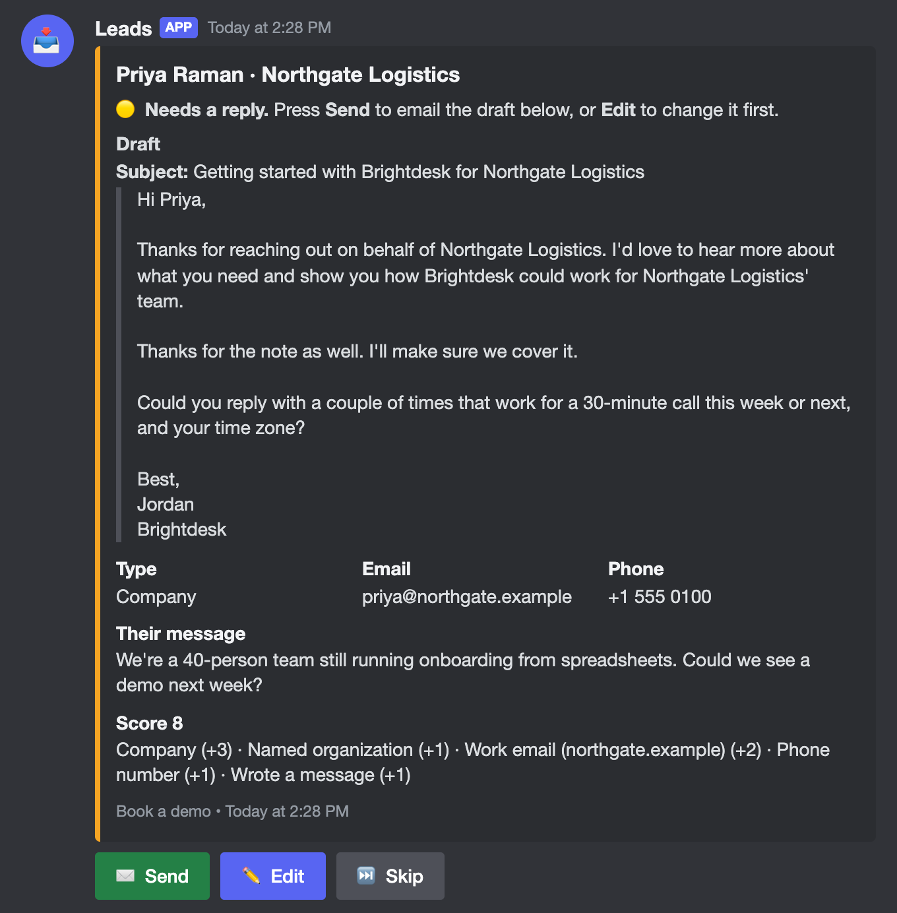
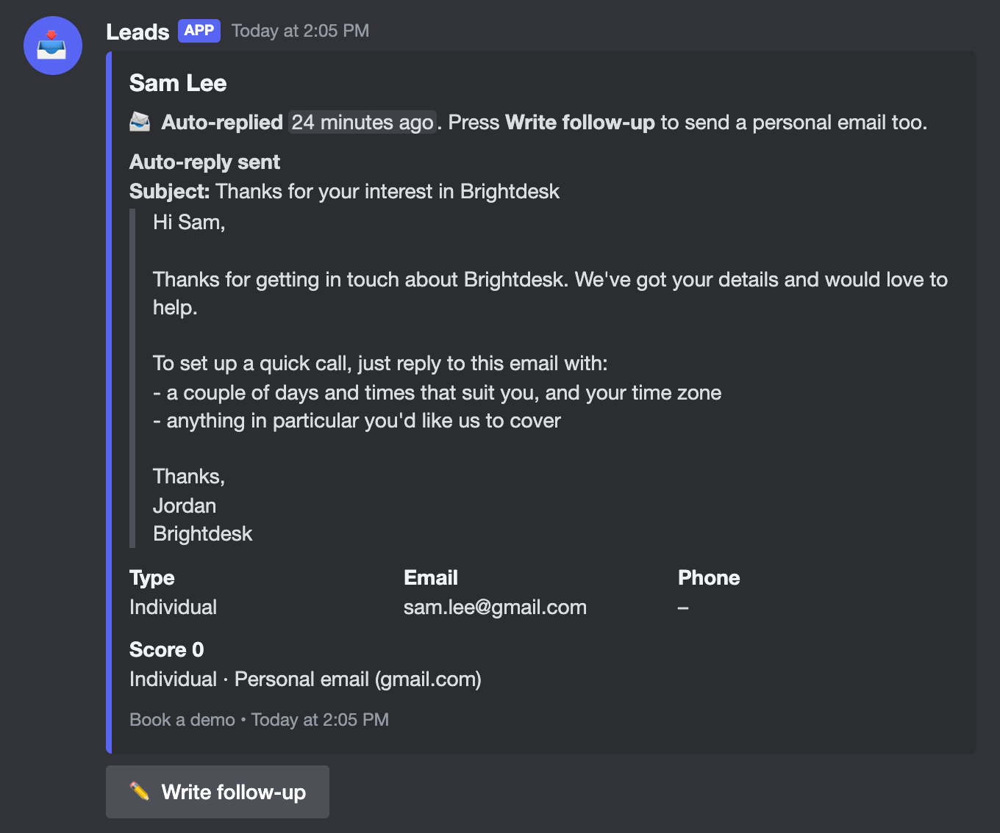
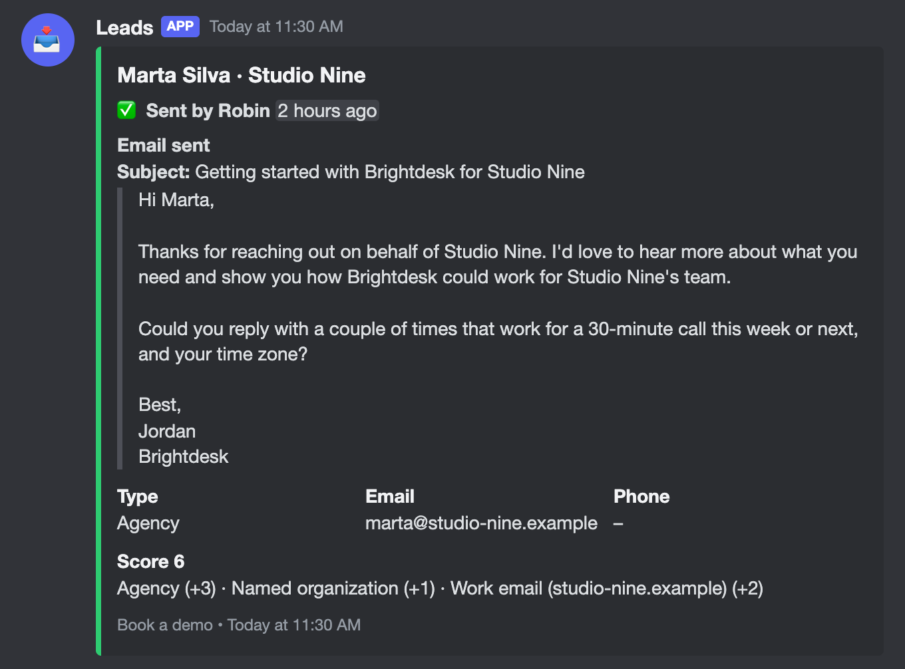
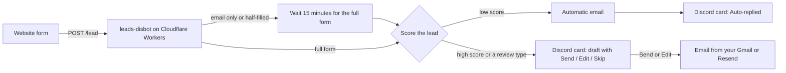

# leads-disbot

[](https://github.com/amriteshdasgupta/leads-disbot/actions/workflows/ci.yml)
[](LICENSE)

A self-hosted Discord bot that triages the leads from your website's contact or demo form.

Every lead becomes a card in a Discord channel. Small leads get a friendly automatic email straight away, and the card says so. Leads worth a personal reply wait as a card with a drafted email and **Send / Edit / Skip** buttons, so your team can answer from Discord in one click.

It runs on Cloudflare Workers (the free plan is enough), stores leads in Workers KV, and sends email from your own Gmail or through [Resend](https://resend.com). Nothing else to host.

<p align="center">
  
</p>

## What you see in Discord

Each lead is one card. Its colour and buttons follow what has happened to it:

<table>
  <tr>
    <td width="50%"></td>
    <td width="50%"></td>
  </tr>
  <tr>
    <td align="center"><sub>A small lead got the automatic email</sub></td>
    <td align="center"><sub>A teammate pressed <b>Send</b></sub></td>
  </tr>
</table>

| Card | Meaning | Buttons |
| --- | --- | --- |
| 🟡 **Needs a reply** | Worth a personal reply. The card shows a drafted email. | ✉️ **Send** · ✏️ **Edit** · ⏭️ **Skip** |
| 📨 **Auto-replied** | Got the automatic email. | ✏️ **Write follow-up** |
| ✅ **Sent by Robin** | Someone sent the email. The card shows what was sent. | none |
| ⏭️ **Skipped by Robin** | Closed without an email. | none |
| ⚠️ **The email didn't send** | Sending failed. The card shows why. | 🔁 **Retry** · ✏️ **Edit** · ⏭️ **Skip** |

- **Send** emails the draft shown on the card.
- **Edit** opens the draft in a pop-up. Change anything, press **Submit**, and it sends.
- **Skip** closes the lead without emailing.
- **Write follow-up** writes a personal email on top of the automatic one.

Cards also show the lead's details (type, email, phone, message) and how they were scored. The bot uses buttons rather than emoji reactions because buttons work through Discord's interactions webhook, so nothing has to stay connected to Discord.

<sub>The images above are the bot's real card output for example leads (`PRODUCT_NAME = "Brightdesk"`, `REVIEW_ORGANIZATION_TYPES = "Company,Agency"`), drawn in Discord's dark theme.</sub>

## How it works



1. Your website posts each form submission to the worker's `/lead` endpoint.
2. The worker scores the lead (see [Scoring](#scoring)). Leads at or above `REVIEW_SCORE`, or of a type listed in `REVIEW_ORGANIZATION_TYPES`, go to Discord with a drafted email. Everyone else gets the automatic email, and Discord shows a card saying so.
3. If someone only typed their email (an email-capture box), or left the form half-filled, the worker waits 15 minutes in case they finish, then handles what it has. A cron trigger every 5 minutes picks these up and retries anything that failed.

## Features

- **Discord-native review**: Send, Edit and Skip from a card; the card updates to show who did what.
- **Automatic replies** for low-value leads, capped per day.
- **Configurable triage**: review threshold, always-review lead types and their labels, all in `wrangler.toml`.
- **Email templates you edit in Discord**: pin a message, and the next lead uses it. No deploy needed.
- **Gmail or Resend**: send from a Gmail account (replies land in its inbox, sent mail in its Sent folder), or from your own domain through Resend.
- **Safe by default**: origin allowlist, honeypot support, one email per address, a daily cap on automatic emails, Ed25519-verified Discord requests, and double-click protection.
- **Small and serverless**: one Cloudflare Worker built with [Hono](https://hono.dev), Workers KV for storage, config validated with [Zod](https://zod.dev).

## Self-hosted, one deployment per server

There is no shared, hosted bot to invite. Each business deploys its own copy, with its own Discord application, KV namespace and email credentials. Your leads stay in your Cloudflare account and your Discord server.

## Quick start

You need:

- Node.js 22 or newer
- A Cloudflare account (free plan is fine)
- A Discord server where you can manage channels and add bots
- A Gmail account with 2-Step Verification, **or** a Resend account with a verified domain

Step-by-step instructions with expected results and troubleshooting are in [docs/deployment.md](docs/deployment.md). The short version:

### 1. Get the code and create the worker's storage

```sh
git clone https://github.com/amriteshdasgupta/leads-disbot.git
cd leads-disbot
npm ci
npx wrangler login
npm run setup
```

`npm run setup` copies `wrangler.example.toml` to `wrangler.toml`, creates the KV namespace, and writes its id into `wrangler.toml`. `wrangler.toml` is gitignored, so your account's IDs never end up in git.

Now open `wrangler.toml` and set the `[vars]` for your business. At least `PRODUCT_NAME`, `SENDER_NAME` and `ALLOWED_ORIGINS`. See [Configuration](#configuration).

### 2. Create the Discord application

1. Go to the [Discord Developer Portal](https://discord.com/developers/applications) and press **New Application**. Name it after your bot, for example `Leads`.
2. On **General Information**, copy the **Application ID** and the **Public Key**.
3. On **Bot**, press **Reset Token** and copy the **bot token**. Leave all the Privileged Gateway Intents **off**; the bot doesn't need them.
4. Invite the bot to your server with this URL, replacing `<APPLICATION_ID>`:

   ```
   https://discord.com/oauth2/authorize?client_id=<APPLICATION_ID>&scope=bot%20applications.commands&permissions=84992
   ```

   `84992` grants exactly the permissions the bot needs:

   | Permission | Value | Why |
   | --- | --- | --- |
   | View Channel | 1024 | See the leads and templates channels |
   | Send Messages | 2048 | Post lead cards |
   | Embed Links | 16384 | Cards are embeds |
   | Read Message History | 65536 | Read the pinned email templates |

5. In Discord, turn on **User Settings → Advanced → Developer Mode**, then right-click the channel where lead cards should appear and **Copy Channel ID**. If the channel is private, give the bot those four permissions in the channel's settings.

You'll set the **Interactions Endpoint URL** after deploying (step 5).

### 3. Set up email

- **Gmail** (default): turn on [2-Step Verification](https://myaccount.google.com/signinoptions/twosv), then create an [app password](https://myaccount.google.com/apppasswords). You'll need the Gmail address and the 16-letter app password.
- **Resend**: verify your domain in Resend, create an API key, and in `wrangler.toml` set `EMAIL_PROVIDER = "resend"` and `FROM_EMAIL`.

### 4. Add the secrets

```sh
cp secrets.example.json secrets.json
# fill in secrets.json (see the secrets table below), then:
npx wrangler secret bulk secrets.json
rm secrets.json
```

### 5. Deploy and connect Discord

```sh
npm run deploy
```

The output ends with your worker URL, like `https://leads-disbot.<your-subdomain>.workers.dev`. Opening it should show `leads-disbot is running`.

Back in the Developer Portal, on **General Information**, set **Interactions Endpoint URL** to `https://leads-disbot.<your-subdomain>.workers.dev/discord` and save. Discord checks the URL before saving, so an error here usually means `DISCORD_PUBLIC_KEY` is wrong.

### 6. Send leads from your website

Post each form submission to `/lead` from a page on one of your `ALLOWED_ORIGINS`:

```js
await fetch("https://leads-disbot.<your-subdomain>.workers.dev/lead", {
  method: "POST",
  headers: { "Content-Type": "application/json" },
  keepalive: true, // still sends if the visitor leaves the page
  body: JSON.stringify({
    email: form.email.value,              // required
    name: form.name.value,                // 2+ characters marks the form as finished
    institution: form.company.value,      // the organization or company name
    organizationType: form.type.value,    // for example "Company", "Agency" or "Individual"
    phone: form.phone.value,
    message: form.message.value,
    sourceForm: "contact_form",           // shown in the card's footer
    sourceUrl: location.href,
    _gotcha: form._gotcha.value,          // honeypot: a hidden field people leave empty
  }),
});
```

The worker answers `{"ok": true}` for every well-formed request, including ones it quietly drops (honeypot hits, invalid emails), so bots learn nothing.

#### Payload fields

All fields are optional except `email`. Unknown fields are ignored, and a field of the wrong type is treated as empty.

| Field | Max length | Meaning |
| --- | --- | --- |
| `email` | 254 | The lead's email address. Leads are keyed by it, so each address is handled once. |
| `name` | 200 | Their name. The first word is used in greetings. |
| `institution` | 200 | Their organization or company name. (The name is kept for compatibility with existing forms.) |
| `organizationType` | 200 | What kind of lead this is, as your form's value (for example `Company`). Drives [scoring](#scoring). `Individual` means a person rather than an organization. |
| `phone` | 200 | Their phone number. |
| `message` | 2000 | Anything they wrote. |
| `sourceForm` | 100 | Which form it came from, shown on the card. |
| `sourceUrl` | 200 | The page it came from. |
| `_gotcha` | 200 | Honeypot. Any value drops the submission. |
| `emailCapture` | | `true` when only an email box was filled in. The worker waits 15 minutes for the full form. |
| `partial` | | `true` when the form was closed half-filled. Treated like `emailCapture`. |
| `capturedEmail` | 254 | The address from an earlier email-capture box, if the full form used a different one. The earlier lead is dropped so the person isn't contacted twice. |

A submission counts as finished when `name` has at least 2 characters and neither `emailCapture` nor `partial` is `true`. Later submissions from the same address fill in missing details until the lead is handled.

## Configuration

### Vars (`wrangler.toml` → `[vars]`)

The worker validates these on every request. If one is wrong, it answers with a 500 and logs exactly what to fix (`npx wrangler tail`). An empty value means "use the default".

| Var | Default | Meaning |
| --- | --- | --- |
| `PRODUCT_NAME` | required | Your product or company name. Used in the built-in emails as `{{product_name}}`. |
| `SENDER_NAME` | required | The name emails are signed with, and the Gmail "From" name. A pinned `SENDER_NAME` message overrides it. |
| `ALLOWED_ORIGINS` | required | Comma-separated origins allowed to post leads, like `https://example.com,https://www.example.com`. No paths or trailing slashes. |
| `EMAIL_PROVIDER` | `gmail` | `gmail` sends from `GMAIL_USER` over SMTP; `resend` sends from `FROM_EMAIL` through Resend. |
| `FROM_EMAIL` | empty | The Resend "From" address, like `Jordan from Example Co <hello@example.com>`. Required for Resend. |
| `AUTO_SEND_DAILY_LIMIT` | `40` | At most this many automatic emails a day (UTC). Past it, leads wait in Discord. `0` turns automatic emails off. |
| `REVIEW_SCORE` | `4` | Leads scoring this or more go to Discord for review. |
| `REVIEW_ORGANIZATION_TYPES` | empty | Comma-separated `organizationType` values that always go to Discord for review, like `Enterprise,Agency`. |
| `ORGANIZATION_TYPE_LABELS` | `{}` | JSON object mapping `organizationType` values to how cards show them, like `{"Agency": "Marketing agency"}`. Unlisted values are shown as they are. |
| `DISCORD_TEMPLATES_CHANNEL_ID` | empty | A channel whose pinned messages override the email templates. Empty uses the built-in ones. See [Editing emails from Discord](#editing-emails-from-discord). |

### Secrets (`npx wrangler secret bulk secrets.json`)

| Secret | Needed for | Meaning |
| --- | --- | --- |
| `DISCORD_BOT_TOKEN` | always | The bot token from the Developer Portal. |
| `DISCORD_PUBLIC_KEY` | always | The application's Public Key, used to verify that button presses really come from Discord. |
| `DISCORD_CHANNEL_ID` | always | The channel lead cards are posted to. |
| `GMAIL_USER` | Gmail | The Gmail address emails come from. |
| `GMAIL_APP_PASSWORD` | Gmail | Its app password. Spaces are fine. |
| `RESEND_API_KEY` | Resend | A Resend API key. |
| `REPLY_TO` | optional | Where replies should go, if not the sending address. |
| `ALLOWED_USER_IDS` | optional | Comma-separated Discord user IDs allowed to press the buttons. Empty lets anyone who can see the channel. |

Missing secrets don't stop the worker: a lead card says "Gmail isn't set up" (or similar) when sending fails, and the logs show Discord errors.

### Scoring

Points are added up for each lead:

| Signal | Points |
| --- | --- |
| `organizationType` is in `REVIEW_ORGANIZATION_TYPES` | +3, and always reviewed |
| Any other `organizationType`, except `Individual` | +1 |
| An organization name (`institution`) | +1 |
| An email that isn't from a free provider (Gmail, Outlook, Yahoo…) | +2 |
| A phone number | +1 |
| A message of 20 characters or more | +1 |

Leads at `REVIEW_SCORE` (default 4) or above go to Discord for review; the rest get the automatic email. The card lists each reason, like `Work email (example.com) (+2)`. The weights live in [`src/score.ts`](src/score.ts) if you want to change them.

## Editing emails from Discord

Without any setup, the bot uses the built-in emails in [`src/templates.ts`](src/templates.ts), filled in with `PRODUCT_NAME` and `SENDER_NAME`. To edit them without deploying:

1. Make a channel such as `#email-templates` that only your team can see, and give the bot View Channel and Read Message History there.
2. Set `DISCORD_TEMPLATES_CHANNEL_ID` to its ID and deploy once.
3. Post and pin these three messages. Each starts with its label and a mention of your bot (the mention lets the bot read the message without the privileged Message Content intent):

   ```
   AUTO_REPLY @YourBot
   Subject: Thanks for your interest in {{product_name}}

   {{greeting}}

   Thanks for getting in touch about {{product_name}}. ...

   Thanks,
   {{sender_name}}
   ```

   ```
   PERSONAL_DRAFT @YourBot
   Subject: Getting started with {{product_name}}{{institution_suffix}}

   {{greeting}}

   Thanks for reaching out{{on_behalf_of}}. ...{{note_acknowledgement}}

   Best,
   {{sender_name}}
   ```

   ```
   SENDER_NAME @YourBot
   Jordan
   ```

- `AUTO_REPLY` is the automatic email. `PERSONAL_DRAFT` is the draft on cards that need a reply. `SENDER_NAME` overrides the `SENDER_NAME` var.
- Keep the label and mention on the first line, and `Subject: ` on the second. Everything below is the body. Subjects can be up to 200 characters and bodies up to 4000.
- To change a template, edit the pinned message (right-click → **Edit Message**) rather than posting a new one. The bot reads the pins for each new lead. Drafts already waiting on cards don't change.
- If a message is missing, duplicated or invalid, the bot uses the last valid version it saw (or the built-in default) and adds a warning to the lead's card. Keep fewer than 50 pins in the channel.

### Placeholders

| Placeholder | Becomes |
| --- | --- |
| `{{first_name}}` | Their first name, or "there" |
| `{{name}}` | Their full name, or "there" |
| `{{email}}` | Their email address |
| `{{institution}}` | Their organization name, or nothing |
| `{{product_name}}` | `PRODUCT_NAME` |
| `{{sender_name}}` | The sender name |
| `{{greeting}}` | "Hi Sam," or "Hi there," |
| `{{on_behalf_of}}` | " on behalf of Northgate", or nothing |
| `{{institution_suffix}}` | " for Northgate", or nothing |
| `{{org_possessive}}` | "Northgate's" (or "Northgate Logistics'"), or "your" |
| `{{note_acknowledgement}}` | A short paragraph thanking them for their message, only when they wrote one |
| `{{paper_owner}}` | Deprecated alias of `{{org_possessive}}`, still accepted |

Text from the lead is never read as a placeholder, and line breaks are stripped from subjects.

## Safety limits

- Only your own websites can submit leads (`ALLOWED_ORIGINS`). Other origins get a 403, preflight requests included.
- Request bodies over 16 KB get a 413, and invalid JSON a 400.
- The honeypot field `_gotcha` is honoured. Dropped submissions still get a 200, so bots learn nothing.
- Each email address is handled once. Submitting again doesn't email them again.
- At most `AUTO_SEND_DAILY_LIMIT` automatic emails a day, so a flood of fake submissions can't make you email strangers. Past that, leads wait in Discord.
- Every Discord request is checked against your application's Ed25519 public key.
- Anyone who can see the leads channel can press the buttons, unless `ALLOWED_USER_IDS` is set. Replies to people who aren't allowed are only visible to them.
- A double click on Send emails once.
- Leads are kept in Workers KV until 60 days after their last update, then deleted automatically. There is no other database.

## Development

```sh
npm ci
npm test            # unit and end-to-end tests, with Discord, Gmail and Resend mocked
npm run typecheck
npm run dev         # local worker on http://localhost:8787
```

`npm run dev` needs a `wrangler.toml` (run `npm run setup`, or copy `wrangler.example.toml`) and a `.dev.vars` file with your secrets, one `NAME=value` per line. Gmail sending only works in a deployed worker, because it needs Cloudflare's TCP sockets.

The code is small:

| File | What it does |
| --- | --- |
| `src/index.ts` | The Hono app: routes, CORS, body limit, and the cron handler |
| `src/config.ts` | Validates vars and secrets with Zod |
| `src/intake.ts` | `POST /lead`: accepts and merges submissions |
| `src/lead.ts` | Parses the form payload |
| `src/score.ts` | Scores leads |
| `src/process.ts` | Auto-replies or drafts, then posts the card |
| `src/discord.ts` | Cards, modals and signature checks |
| `src/interactions.ts` | `POST /discord`: Send, Edit and Skip |
| `src/templates.ts` | Built-in emails and placeholders |
| `src/discord-templates.ts` | Reads templates pinned in Discord |
| `src/email.ts` | Sends through Gmail or Resend |
| `src/store.ts` | Workers KV storage and the daily cap |

See [CONTRIBUTING.md](CONTRIBUTING.md) before opening a pull request.

## License

[MIT](LICENSE) © 2026 Amritesh Dasgupta
